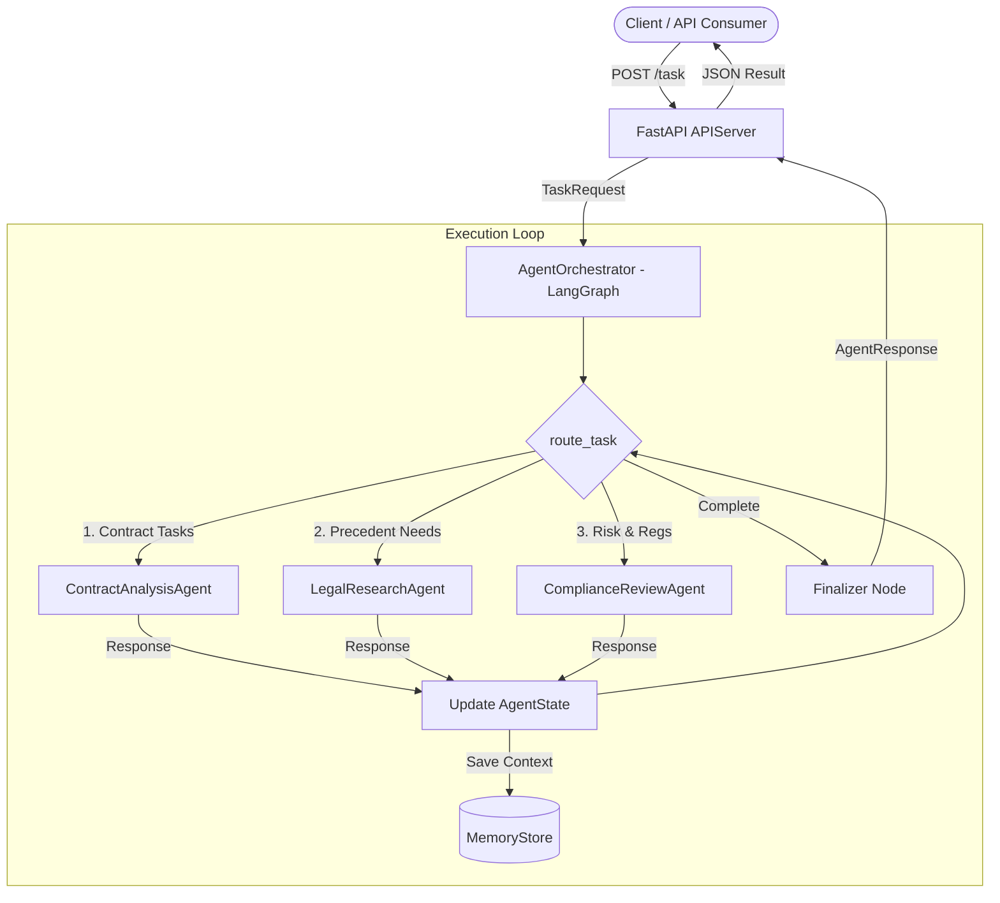

# AgentX — Multi-Agent Collaboration Framework

[](https://www.python.org/)
[](https://fastapi.tiangolo.com/)
[](https://github.com/langchain-ai/langgraph)
[](https://www.langchain.com/)
[](LICENSE)
[]()

> **AgentX** is an enterprise-grade multi-agent collaboration framework engineered with **LangGraph**, **LangChain**, and **FastAPI**. It organizes specialized AI agents to autonomously and collaboratively analyze, research, and review complex legal workflows with dynamic routing, state persistence, and fault tolerance.

---

## Table of Contents
1. [Domain Problem & How AgentX Solves It](#domain-problem--how-agentx-solves-it)
2. [How It Works](#how-it-works)
3. [System Architecture](#system-architecture)
4. [Class & Interface Design](#class--interface-design)
5. [Data Structures & Schemas](#data-structures--schemas)
6. [Orchestration Flow & Algorithms](#orchestration-flow--algorithms)
7. [Enterprise Error Handling & Resilience](#enterprise-error-handling--resilience)
8. [How We Built It](#how-we-built-it)
9. [Project Structure](#project-structure)
10. [Setup & Installation](#setup--installation)
11. [Running the System](#running-the-system)
12. [API Reference & Examples](#api-reference--examples)
13. [Testing & Quality Assurance](#testing--quality-assurance)

---

## Domain Problem & How AgentX Solves It

### The Legal Domain Dilemma
Enterprise legal operations (such as contract negotiation, M&A due diligence, and regulatory compliance) suffer from critical structural challenges:
- **Cognitive Overload & Multidisciplinary Demands**: A single contract review requires distinct competencies: contractual clause analysis, liability exposure estimation, relevant statutory/case law precedent research, and jurisdictional regulatory compliance (e.g., GDPR, CCPA, FCPA).
- **Failure of Monolithic LLM Prompts**: Feeding an entire 50-page legal agreement into a single, generic prompt produces high rates of hallucination, missed risk clauses, shallow research, and non-deterministic results without an audit trail.
- **Strict Need for Verifiability & Resilience**: Legal teams cannot tolerate black-box systems that fail silently when an external API experiences downtime or rate limits.

### The AgentX Solution
AgentX decomposes complex legal tasks into a coordinated, multi-agent pipeline governed by strict state boundaries:

1. **Division of Labor**: Discrete, purpose-built agents focus on specialized subtasks:
   - **Contract Analysis Specialist**: Scans agreement language, flags indemnities, termination covenants, and liability caps.
   - **Legal Research Specialist**: Contextualizes contracts against statutory codes (e.g., UCC Article 2, Restatements) and precedent citations (e.g., *Hadley v. Baxendale*).
   - **Compliance Review Specialist**: Evaluates cross-border regulatory constraints (GDPR, CCPA, export control, corporate governance) and outputs risk scores.
2. **Dynamic Context-Aware Graph Routing**: Powered by **LangGraph**, the orchestrator tracks workflow state, routes tasks based on payload context, and passes progressive findings downstream.
3. **Auditable Context Memory**: Persists every agent interaction and state change in a unified `MemoryStore`.
4. **Deterministic Fallback Engines**: When external LLMs (e.g., OpenAI) encounter outages or missing API keys, AgentX gracefully switches to deterministic legal rule engines, ensuring uninterrupted business operations.

---

## How It Works



1. **Task Ingestion**: The client posts a `TaskRequest` containing contract clauses, metadata, and jurisdiction to the FastAPI server.
2. **State Initialization**: The orchestrator instantiates an `AgentState` object configuring the task context, execution trajectory, and step limits.
3. **Dynamic Routing**: The LangGraph router selects the next qualified agent (e.g., Contract Analyst -> Legal Researcher -> Compliance Officer).
4. **Agent Subtask Execution**:
   - The agent inspects accumulated context.
   - Executes with exponential backoff on LLM calls.
   - On LLM failure or offline mode, executes domain-specific fallback analysis.
5. **Context Aggregation & Memory Persistence**: The agent's structured response is merged into `AgentState.context` and committed to the `MemoryStore`.
6. **Completion**: Once all requirements are satisfied or max steps are reached, the orchestrator packages an `AgentResponse` and returns it to the client.

---

## System Architecture

The architecture mirrors the five core pillars outlined in the **AgentX Low Level Design (LLD)**:

| Component | Technology | Primary Responsibilities |
| :--- | :--- | :--- |
| **API Layer** | FastAPI | Expose HTTP endpoints, validate input schemas, return HTTP 400 on bad requests, provide real-time status. |
| **Orchestrator** | LangGraph | Manage state graph, execute dynamic routing edges, coordinate agent handoffs, enforce timeouts. |
| **Agent Manager** | LangChain | Maintain agent registry, instantiate and configure agents, look up agents by identifier. |
| **Specialized Agents**| LangChain / OpenAI | Execute domain subtasks, query LLM or fallback engines, maintain local memory context. |
| **Memory Store** | In-Memory / DB | Persist execution context, support retry upon transient backend failure. |

---

## Class & Interface Design

### 1. `APIServer` (`agentx/api/server.py`)
- `POST /task`: Ingests and processes `TaskRequest`, returns `AgentResponse`.
- `GET /status`: Retrieves system health, agent registry status, or specific task execution states.
- `GET /task/{task_id}`: Inspects detailed history of processed tasks.

### 2. `AgentOrchestrator` (`agentx/orchestrator/orchestrator.py`)
- `run_workflow(task_request: TaskRequest) -> AgentResponse`: Synchronous orchestration loop.
- `arun_workflow(task_request: TaskRequest) -> AgentResponse`: Asynchronous workflow loop with `asyncio.wait_for` timeout enforcement.
- `route_task(state: AgentState) -> Optional[str]`: Evaluates current state context to return the next agent ID.
- `state`: Property returning the active `AgentState`.

### 3. `AgentManager` (`agentx/agents/manager.py`)
- `register_agent(agent: LegalAgent) -> None`: Registers an agent instance.
- `get_agent(agent_id: str) -> Optional[LegalAgent]`: Retrieves registered agent.
- `list_agents() -> List[str]`: Returns IDs of all active agents.
- `create_default(memory_store) -> AgentManager`: Factory pre-configured with default legal specialists.

### 4. `LegalAgent` Base Class (`agentx/agents/base.py`)
- `process_input(context: Dict[str, Any]) -> AgentResponse`: Core execution method wrapped with error handling and fallback generation.
- `_call_llm_with_backoff(prompt: str) -> str`: External LLM invocation with Tenacity exponential backoff.
- `_execute_subtask(context: Dict[str, Any]) -> Dict[str, Any]`: Abstract domain subtask logic.
- `_generate_fallback(context: Dict[str, Any], reason: str) -> Dict[str, Any]`: Abstract deterministic fallback generator.

### 5. `MemoryStore` (`agentx/memory/in_memory.py`)
- `save_context(agent_id, context, conversation_id)`: Persists agent context with built-in retry logic.
- `load_context(agent_id, conversation_id)`: Retrieves history of stored records.

---

## Data Structures & Schemas

Defined using Pydantic v2 in `agentx/models/schemas.py`:

```python
class TaskRequest(BaseModel):
    task_id: str                          # Unique task identifier
    input_data: Dict[str, Any]            # Document text, clauses, queries
    metadata: Dict[str, Any]              # Priority, pipeline hints, task type

class AgentState(BaseModel):
    agent_id: Optional[str]               # Active agent ID
    context: Dict[str, Any]               # Accumulated workflow context
    history: List[Dict[str, Any]]         # Step-by-step audit trajectory
    status: str                           # pending, running, completed, aborted, failed

class AgentResponse(BaseModel):
    task_id: str                          # Identifier of completed task
    output_data: Dict[str, Any]           # Aggregated multi-agent findings
    status: str                           # completed, fallback, aborted, failed
    errors: List[str]                     # Warnings or error details

class MemoryRecord(BaseModel):
    agent_id: str                         # Author agent
    conversation_id: str                  # Task or conversation ID
    data: Dict[str, Any]                  # Context snapshot
    timestamp: datetime                   # UTC timestamp
```

---

## Orchestration Flow & Algorithms

The system implements the exact orchestration logic specified in Section 4 of the LLD:

```python
def run_workflow(task_request):
    state = initialize_state(task_request)
    while not state.is_complete():
        agent = select_next_agent(state)
        response = agent.process_input(state.context)
        state.update(response)
        MemoryStore.save_context(agent.id, state.context)
    return state.final_output()
```

### LangGraph Implementation Details
The loop is compiled into a `StateGraph`:
1. **`router` node**: Invokes `orchestrator.route_task(state)` and evaluates whether `state.is_complete()` is True.
2. **Conditional Edge**: Routes to `executor` if an agent is selected, or transitions to `finalizer` if complete.
3. **`executor` node**: Calls `agent.process_input()`, persists memory, updates context, and branches back to `router`.
4. **`finalizer` node**: Consolidates status, flags warnings, and terminates at `END`.

---

## Enterprise Error Handling & Resilience

The framework adheres to the error matrix defined in LLD Section 5:

| Failure Scenario | Strategy | Code Implementation |
| :--- | :--- | :--- |
| **Invalid API request** | Return HTTP 400 with descriptive error message | FastAPI `RequestValidationError` handler & payload validation in `create_task()` |
| **Agent processing failure** | Log error, update status, return fallback | `try...except` in `LegalAgent.process_input()`; populates `output_data` with rule engine fallback |
| **Memory store unavailable** | Retry with backoff, else return error to orchestrator | `InMemoryStore.save_context()` retry loop; raises `MemoryStoreUnavailableError` |
| **External API (OpenAI) failure** | Exponential backoff, fallback response | Tenacity `@retry(wait_exponential, stop=3)` in `LegalAgent._call_llm_with_backoff()`; returns structured fallback |
| **Workflow timeout** | Abort workflow, return partial results | `asyncio.wait_for()` in `AgentOrchestrator.arun_workflow()`; sets status to `aborted` with collected context |

---

## How We Built It

The implementation was built incrementally from scratch following clean-code principles:

1. **Foundational Specifications & Models**:
   - Studied the official LLD document ([AgentX---Multi-Agent-Collaboration-Framework-lld-RlR31.pdf](AgentX---Multi-Agent-Collaboration-Framework-lld-RlR31.pdf)).
   - Modeled domain schemas in `agentx/models/schemas.py` using Pydantic v2.
2. **Memory Subsystem**:
   - Built `MemoryStore` ABC and `InMemoryStore` with resilient retry loops and fault injection hooks.
3. **Specialized Legal Agent Engine**:
   - Implemented `LegalAgent` base class integrating Tenacity exponential backoff for external LLM calls and domain fallback generators.
   - Built `ContractAnalysisAgent`, `LegalResearchAgent`, and `ComplianceReviewAgent`.
   - Created `AgentManager` to decouple agent instantiation from orchestration.
4. **LangGraph State Orchestration**:
   - Constructed a cyclical `StateGraph` connecting router, executor, and finalizer nodes.
   - Added `asyncio.wait_for` timeout handling to gracefully abort stalled workflows.
5. **FastAPI HTTP Service**:
   - Exposed `POST /task` and `GET /status`.
   - Implemented custom exception handlers returning HTTP 400 for bad payloads.
6. **Automated Verification**:
   - Wrote 14 comprehensive unit and integration tests across API, memory, agent, and orchestrator modules.
   - Built `test_workflow.py` for end-to-end demonstrations.

---

## Project Structure

```
.
├── .env                       # Local active environment configuration
├── .env.example               # Template environment configuration
├── .gitignore                 # Git ignore rules (venv, caches, env)
├── README.md                  # Comprehensive framework documentation
├── requirements.txt           # Project dependencies
├── main.py                    # Production server entrypoint
├── test_workflow.py           # End-to-end workflow demonstration script
├── AgentX---Multi-Agent...pdf # Original LLD Specification document
├── agentx/
│   ├── __init__.py
│   ├── config.py              # Configuration & settings management
│   ├── models/
│   │   ├── __init__.py
│   │   └── schemas.py         # TaskRequest, AgentState, AgentResponse, MemoryRecord
│   ├── memory/
│   │   ├── __init__.py
│   │   ├── base.py            # MemoryStore abstract base class
│   │   └── in_memory.py       # InMemoryStore with retry mechanism
│   ├── agents/
│   │   ├── __init__.py
│   │   ├── base.py            # LegalAgent base class with LLM backoff & fallback
│   │   ├── manager.py         # AgentManager registry
│   │   └── specialized.py     # ContractAnalysis, LegalResearch, ComplianceReview
│   ├── orchestrator/
│   │   ├── __init__.py
│   │   └── orchestrator.py    # LangGraph StateGraph AgentOrchestrator
│   └── api/
│       ├── __init__.py
│       └── server.py          # FastAPI application & route endpoints
└── tests/
    ├── __init__.py
    ├── test_agents.py         # Agent subtask & fallback tests
    ├── test_api.py            # Endpoint & HTTP 400 validation tests
    ├── test_memory.py         # Memory persistence & retry tests
    └── test_orchestrator.py   # Multi-agent LangGraph workflow & timeout tests
```

---

## Setup & Installation

### 1. Prerequisites
- Python 3.10 or higher (fully tested on Python 3.14)
- Git

### 2. Clone Repository
```bash
git clone https://github.com/niraj987/AgentX-Multi-Agent-Collaboration-Framework.git
cd AgentX-Multi-Agent-Collaboration-Framework
```

### 3. Create & Activate Virtual Environment
**On Windows (PowerShell):**
```powershell
python -m venv venv
.\venv\Scripts\Activate.ps1
```

**On Linux / macOS:**
```bash
python3 -m venv venv
source venv/bin/activate
```

### 4. Install Dependencies
```bash
pip install -r requirements.txt
```

### 5. Configure Environment Variables
Copy `.env.example` to `.env`:
```bash
cp .env.example .env
```
Configure your settings:
```env
OPENAI_API_KEY=sk-...           # Optional: Leave blank to use built-in deterministic fallback engine
OPENAI_MODEL=gpt-4o-mini
API_HOST=127.0.0.1
API_PORT=8000
WORKFLOW_TIMEOUT_SECONDS=30
```

---

## Running the System

### 1. Launch the FastAPI Server
```bash
python main.py
```
Or directly with Uvicorn:
```bash
uvicorn agentx.api.server:app --host 127.0.0.1 --port 8000 --reload
```
Interactive API documentation:
- **Swagger UI**: [http://127.0.0.1:8000/docs](http://127.0.0.1:8000/docs)
- **ReDoc**: [http://127.0.0.1:8000/redoc](http://127.0.0.1:8000/redoc)

### 2. Run the Interactive Workflow Demo
Run the end-to-end multi-agent execution pipeline directly:
```bash
python test_workflow.py
```

---

## API Reference & Examples

### Endpoint 1: Health & System Status
```http
GET /status
```
**Sample Response:**
```json
{
  "status": "healthy",
  "framework": "AgentX Multi-Agent Collaboration Framework",
  "timestamp": "2026-10-13T01:00:00Z",
  "registered_agents": [
    "contract_analyst",
    "legal_researcher",
    "compliance_officer"
  ],
  "tasks_processed": 1,
  "orchestrator_state": "idle"
}
```

### Endpoint 2: Submit Legal Review Task
```http
POST /task
Content-Type: application/json
```
**Request Body:**
```json
{
  "task_id": "contract-review-2026-001",
  "input_data": {
    "contract_title": "Enterprise Cloud Services Agreement",
    "document_text": "Vendor provides cloud hosting. Vendor liability is capped at $50,000, except Customer indemnifies Vendor without limitation for all patent and data claims. Either party may terminate with 30 days notice. Governed by Delaware law.",
    "jurisdiction": "Delaware / United States"
  },
  "metadata": {
    "task_type": "full_review",
    "priority": "high",
    "client": "Acme Corp"
  }
}
```
**Response (200 OK):**
```json
{
  "task_id": "contract-review-2026-001",
  "output_data": {
    "contract_analysis": {
      "detected_clauses": [
        "Indemnification Clause",
        "Termination Clause",
        "Limitation of Liability"
      ],
      "identified_risks": [
        "High risk: Broad indemnification scope detected"
      ],
      "recommendations": [
        "Ensure mutual limitation of liability cap is defined",
        "Verify notice period for termination for convenience"
      ]
    },
    "legal_research": {
      "jurisdiction": "Delaware / United States",
      "relevant_statutes": [
        "Uniform Commercial Code (UCC) Article 2 (Sales)",
        "Restatement (Second) of Contracts § 90, § 205 (Good Faith)"
      ],
      "case_precedents": [
        "Hadley v. Baxendale (Foreseeability of Consequential Damages)",
        "Morin Building Products Co. v. Baystone Construction, Inc."
      ]
    },
    "compliance_review": {
      "compliance_score": 92,
      "regulatory_frameworks_checked": [
        "GDPR / Privacy",
        "CCPA",
        "Export Controls",
        "SOX"
      ],
      "compliance_status": "COMPLIANT_WITH_CONDITIONS",
      "action_items": [
        "Add Data Processing Addendum (DPA) if personal data is transferred",
        "Include dispute resolution and arbitration clauses"
      ]
    }
  },
  "status": "completed",
  "errors": []
}
```

### Endpoint 3: Invalid Request Error (HTTP 400)
Submitting an empty `task_id` or malformed payload returns:
```json
{
  "detail": "Invalid API request: 'task_id' must not be empty"
}
```

---

## Testing & Quality Assurance

The framework includes a comprehensive test suite in `tests/` covering every component and edge case:

```bash
pytest -v
```

**Test Execution Results:**
```
tests/test_agents.py::test_agent_manager_registration PASSED             [  7%]
tests/test_agents.py::test_contract_analysis_agent_fallback PASSED       [ 14%]
tests/test_agents.py::test_legal_research_agent PASSED                   [ 21%]
tests/test_agents.py::test_compliance_review_agent PASSED                [ 28%]
tests/test_api.py::test_api_status_endpoint PASSED                       [ 35%]
tests/test_api.py::test_api_create_task_success PASSED                   [ 42%]
tests/test_api.py::test_api_invalid_request_empty_task_id PASSED         [ 50%]
tests/test_api.py::test_api_invalid_request_malformed_json PASSED        [ 57%]
tests/test_memory.py::test_in_memory_store_save_and_load PASSED          [ 64%]
tests/test_memory.py::test_in_memory_store_retry_and_failure PASSED      [ 71%]
tests/test_memory.py::test_in_memory_store_recovery PASSED               [ 78%]
tests/test_orchestrator.py::test_orchestrator_multi_agent_workflow PASSED [ 85%]
tests/test_orchestrator.py::test_orchestrator_single_agent_pipeline PASSED [ 92%]
tests/test_orchestrator.py::test_orchestrator_timeout_handling PASSED    [100%]

============================= 14 passed in 1.94s ==============================
```

---

## License

This project is licensed under the MIT License - see the [LICENSE](LICENSE) file for details.
